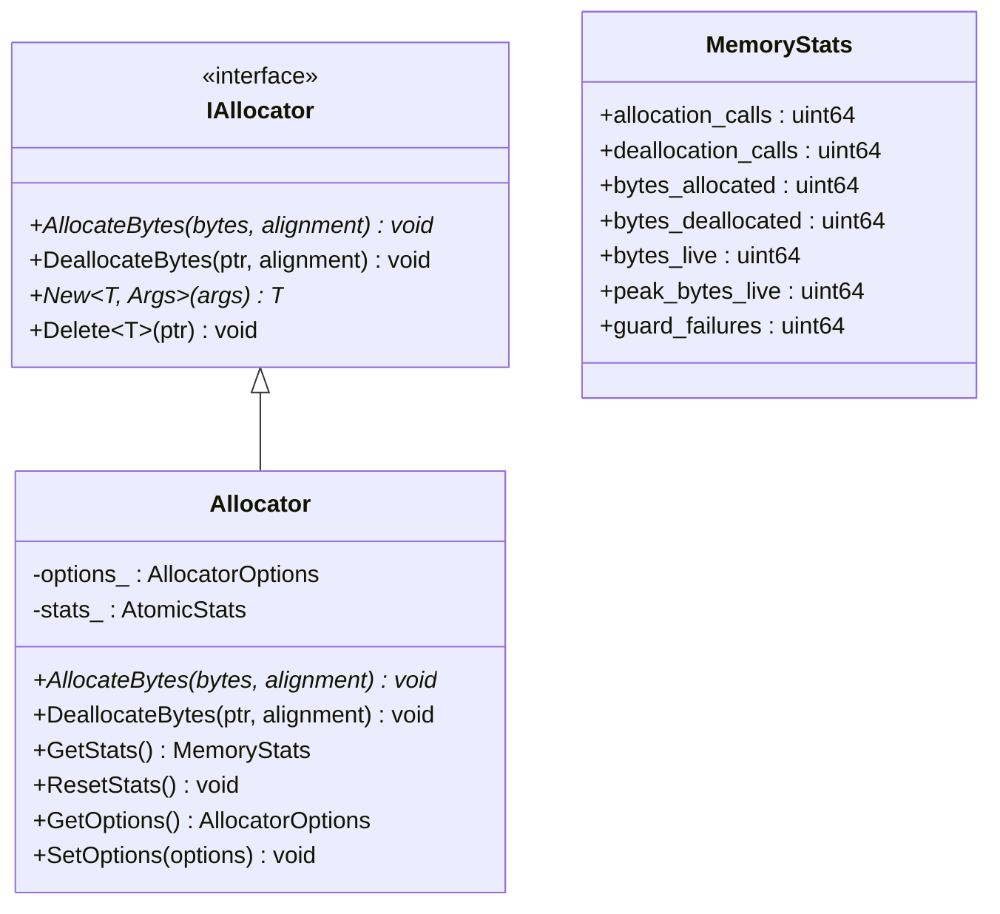
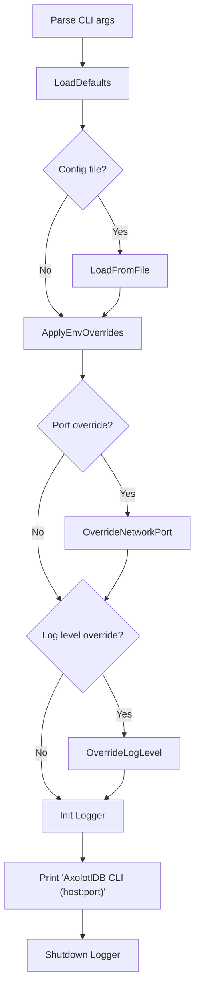

# AxolotlDB — Core Module Documentation

> **Version**: 0.1.0 · **Standard**: C++20 · **Namespace**: `AxolotlDB::utils`

This document covers every **implemented** core module in the Axolotl project. Modules that are currently scaffolded (empty stubs) are listed at the bottom for reference.

---

## Table of Contents

1. [ConfigManager](#1-configmanager)
2. [Logger](#2-logger)
3. [Memory Allocator](#3-memory-allocator)
4. [CLI Entry Point](#4-cli-entry-point)
5. [Allocator Benchmark](#5-allocator-benchmark)
6. [Stub Modules (Not Yet Implemented)](#6-stub-modules-not-yet-implemented)

---

## 1. ConfigManager

| | |
|---|---|
| **Header** | [`include/utils/config.h`](file:///c:/Users/youss/Desktop/project%231/Axolotl/include/utils/config.h) |
| **Source** | [`src/utils/config.cpp`](file:///c:/Users/youss/Desktop/project%231/Axolotl/src/utils/config.cpp) |
| **Tests** | [`tests/unit/config_test.cpp`](file:///c:/Users/youss/Desktop/project%231/Axolotl/tests/unit/config_test.cpp) |
| **Dependencies** | `yaml-cpp` |
| **Lines of code** | ~365 (header + source) |

### Purpose

A **singleton-style static configuration manager** that loads, validates, and serves application-wide settings from YAML files, raw YAML strings, sensible defaults, and environment variable overrides.

### Configuration Sections

The `AppConfig` struct aggregates six sub-configs:

| Sub-Config | Struct | Key Settings |
|---|---|---|
| **Database** | `DatabaseConfig` | `name` (`"AxolotlDB"`), `data_dir` (`"./data"`), `max_connections` (`100`) |
| **Storage** | `StorageConfig` | `page_size` (`4096`), `buffer_pool_size` (`1000`), `checkpoint_interval` (`300`), `sync_writes` (`true`) |
| **Logging** | `LoggingConfig` | `level` (`"info"`), `file` (`"logs/AxolotlDB.log"`), `async` (`true`), `max_file_size_mb` (`10`), `max_files` (`5`) |
| **Network** | `NetworkConfig` | `host` (`"127.0.0.1"`), `port` (`6969`), `thread_pool_size` (`8`), `connection_timeout_ms` (`5000`), `max_packet_size_bytes` (`65536`) |
| **Vector** | `VectorConfig` | `default_dimension` (`768`), `distance_metric` (`"cosine"`), plus nested `HnswConfig` (`m=16`, `ef_construction=200`, `ef_search=50`) |
| **Query** | `QueryConfig` | `max_result_rows` (`10000`), `join_buffer_size_mb` (`32`), `enable_optimizer` (`true`) |

### Public API

```cpp
class ConfigManager {
public:
    // ---- Loading ----
    static void LoadFromFile(const std::string& yaml_path);   // Load from a YAML file on disk
    static void LoadFromString(const std::string& yaml_content); // Load from an in-memory YAML string
    static void LoadDefaults();                                 // Use compile-time defaults only

    // ---- Environment overrides ----
    static void ApplyEnvOverrides();  // Reads AxolotlDB_* env vars and overwrites matching fields

    // ---- Accessors ----
    static const AppConfig&      Get();
    static const DatabaseConfig& Database();
    static const StorageConfig&  Storage();
    static const LoggingConfig&  Logging();
    static const NetworkConfig&  Network();
    static const VectorConfig&   Vector();
    static const QueryConfig&    Query();

    // ---- Runtime Overrides ----
    static void OverrideNetworkPort(uint16_t port);
    static void OverrideLogLevel(const std::string& level);

    // ---- Lifecycle ----
    static bool IsInitialized();
    static void Reset();  // Resets to uninitialized state
};
```

### Loading Priority

```
LoadDefaults() → LoadFromFile() / LoadFromString() → ApplyEnvOverrides() → Manual Overrides
```

Each step validates the entire config via `Validate()` before accepting it.

### Environment Variables

| Env Variable | Overrides |
|---|---|
| `AxolotlDB_NETWORK_PORT` | `network.port` |
| `AxolotlDB_NETWORK_HOST` | `network.host` |
| `AxolotlDB_NETWORK_THREAD_POOL_SIZE` | `network.thread_pool_size` |
| `AxolotlDB_STORAGE_BUFFER_POOL_SIZE` | `storage.buffer_pool_size` |
| `AxolotlDB_STORAGE_SYNC_WRITES` | `storage.sync_writes` |
| `AxolotlDB_LOGGING_LEVEL` | `logging.level` |
| `AxolotlDB_DATABASE_DATA_DIR` | `database.data_dir` |

### Validation Rules

| Field | Rule |
|---|---|
| `storage.page_size` | Must be a power of 2 (e.g. 4096, 8192) |
| `storage.buffer_pool_size` | Must be > 0 |
| `network.port` | Must be 1–65535 |
| `network.thread_pool_size` | Must be > 0 |
| `logging.level` | Must be one of: `trace`, `debug`, `info`, `warn`, `error`, `critical`, `off` |
| `vector.distance_metric` | Must be one of: `cosine`, `l2`, `dot` |
| `vector.default_dimension` | Must be > 0 |
| `vector.hnsw.ef_construction` | Must be ≥ `vector.hnsw.m` |
| `database.max_connections` | Must be > 0 |

### Exceptions

| Exception | When |
|---|---|
| `ConfigException` | File not found, parse errors, invalid env values, access before init |
| `ConfigValidationError` | Any validation rule fails (inherits `ConfigException`) |

### Example YAML

```yaml
database:
  name: "mydb"
  data_dir: "./data"
  max_connections: 50

storage:
  page_size: 4096
  buffer_pool_size: 2000
  sync_writes: true

logging:
  level: "debug"
  file: "logs/AxolotlDB.log"
  async: true

network:
  host: "0.0.0.0"
  port: 7777
  thread_pool_size: 4

vector:
  default_dimension: 384
  distance_metric: "l2"
  hnsw:
    m: 32
    ef_construction: 400
    ef_search: 100

query:
  max_result_rows: 5000
  enable_optimizer: true
```

### Test Coverage

| Test Case | Description |
|---|---|
| `GetBeforeInitThrows` | Calling `Get()` before any `Load*()` throws `ConfigException` |
| `LoadDefaultsInitializesConfig` | Defaults set port=6969, level="info" |
| `LoadFromStringReadsYamlValues` | Parses host, port, level, distance_metric from YAML string |
| `LoadFromStringRejectsInvalidConfig` | Non-power-of-2 page_size throws `ConfigValidationError` |
| `ApplyEnvOverridesUpdatesValues` | Env vars override port, sync_writes, level |
| `ApplyEnvOverridesRejectsInvalidBool` | Invalid boolean value ("maybe") throws `ConfigException` |

---

## 2. Logger

| | |
|---|---|
| **Header** | [`include/utils/logger.h`](file:///c:/Users/youss/Desktop/project%231/Axolotl/include/utils/logger.h) |
| **Source** | [`src/utils/logger.cpp`](file:///c:/Users/youss/Desktop/project%231/Axolotl/src/utils/logger.cpp) |
| **Tests** | [`tests/unit/logger_test.cpp`](file:///c:/Users/youss/Desktop/project%231/Axolotl/tests/unit/logger_test.cpp) |
| **Dependencies** | `spdlog` (v1.12.0) |
| **Lines of code** | ~170 (header + source) |

### Purpose

A **static logging facade** wrapping [spdlog](https://github.com/gabime/spdlog) that provides:
- Dual output to **console** (colored) and **rotating file**
- **Synchronous or asynchronous** logging modes
- Seven log levels with convenient macros
- Custom sink injection for testing

### Log Levels

```cpp
enum class LogLevel {
    kTrace, kDebug, kInfo, kWarn, kError, kCritical, kOff
};
```

> **Note (audit B3):** The enum was renamed from `ALLCAPS` to `kPascal` style to
> avoid collisions with POSIX/Windows macros (`ERROR`, `DEBUG`). Macro definitions
> `LOG_TRACE(...)` through `LOG_CRITICAL(...)` remain unchanged.

### Public API

```cpp
class Logger {
public:
    // Full initialization with file rotation
    static void Init(const std::string& logger_name,
                     const std::string& log_file_path,
                     LogLevel level = LogLevel::kInfo,
                     bool async = false,
                     size_t mx_file_sz = 10 * 1024 * 1024,  // 10 MB
                     size_t mx_files = 3);

    // Test-friendly initialization with custom sinks
    static void InitWithSinks(const std::string& loggerName,
                              std::vector<spdlog::sink_ptr> sinks,
                              LogLevel level = LogLevel::kDebug);

    static void Shutdown();              // Flush and destroy
    static spdlog::logger* Get();        // Access the underlying spdlog instance
    static void SetLevel(LogLevel level); // Runtime level change
};
```

### Convenience Macros

These macros automatically include source location information (`__FILE__`, `__LINE__`):

```cpp
LOG_TRACE(...)     // Finest-grained diagnostic messages
LOG_DEBUG(...)     // Debugging information
LOG_INFO(...)      // General operational messages
LOG_WARN(...)      // Warnings that don't interrupt operation
LOG_ERROR(...)     // Errors that affect functionality
LOG_CRITICAL(...)  // Fatal errors that may crash the system
```

### Output Format

| Sink | Pattern | Example |
|---|---|---|
| Console | `[HH:MM:SS.mmm] [LEVEL] [thread_id] message` | `[14:32:05.123] [info] [12345] Server started` |
| File | `[HH:MM:SS.mmm] [level] [thread_id] message` | Same, but without color codes |

### Behavior Details

- **Async mode**: Uses an 8192-entry thread pool; overflow policy is `block` (backpressure)
- **File rotation**: Rotates when max file size is reached; keeps up to `mx_files` backups
- **Flush policy**: Auto-flush on `warn` level and above
- **Safety**: `Get()` asserts the logger has been initialized; calling it before `Init()` aborts

### Usage Example

```cpp
#include <utils/logger.h>

// Initialize
AxolotlDB::utils::Logger::Init("myapp", "logs/app.log", 
    AxolotlDB::utils::LogLevel::kDebug, /*async=*/true);

// Use the macros
LOG_INFO("Server listening on port {}", 6969);
LOG_WARN("Buffer pool utilization at {}%", 85);
LOG_ERROR("Failed to open file: {}", filename);

// Cleanup
AxolotlDB::utils::Logger::Shutdown();
```

### Test Coverage

| Test Case | Description |
|---|---|
| `WritesMessageToFile` | Initializes logger, writes a message, verifies it appears in the log file |

---

## 3. Memory Allocator

| | |
|---|---|
| **Header** | [`include/utils/memory.h`](file:///c:/Users/youss/Desktop/project%231/Axolotl/include/utils/memory.h) |
| **Source** | [`src/utils/memory.cpp`](file:///c:/Users/youss/Desktop/project%231/Axolotl/src/utils/memory.cpp) |
| **Tests** | [`tests/unit/memory_test.cpp`](file:///c:/Users/youss/Desktop/project%231/Axolotl/tests/unit/memory_test.cpp) |
| **Benchmark** | [`benchmarks/vector_bench/allocator_bench.cpp`](file:///c:/Users/youss/Desktop/project%231/Axolotl/benchmarks/vector_bench/allocator_bench.cpp) |
| **Lines of code** | ~250 (header + source) |

### Purpose

A **memory allocation subsystem** with optional tracking and guard-page corruption detection. Designed to be the foundation for all internal memory management in AxolotlDB — from buffer pool pages to B+ tree nodes and vector index structures.

### Architecture



### Operating Modes

| Mode | `enable_tracking` | `enable_guards` | Overhead | Use Case |
|---|---|---|---|---|
| **Raw** | `false` | `false` | Zero | Production hot paths |
| **Tracking** | `true` | `false` | ~16 bytes/alloc | Monitoring & leak detection |
| **Full Guard** | `true` | `true` | ~24 bytes/alloc | Debug heap corruption |

### Memory Layout (Tracking + Guards Enabled)

```
┌──────────────────┬─────────────────┬──────────────────┐
│ AllocationHeader │   User Memory   │ AllocationFooter │
│ (head_guard +    │   (N bytes)     │ (tail_guard)     │
│  size field)     │                 │                  │
└──────────────────┴─────────────────┴──────────────────┘
  head_guard = 0xA110C0DECAFEBABE      tail_guard = 0xBADF00D0D15EA5E5
```

- The header is `alignas(std::max_align_t)` to preserve alignment guarantees
- On deallocation, both guards are checked; mismatches increment `guard_failures`

### Public API

```cpp
// Abstract interface — allows custom allocators
class IAllocator {
public:
    virtual void* AllocateBytes(std::size_t bytes, std::size_t alignment) = 0;
    virtual void DeallocateBytes(void* ptr, std::size_t alignment) noexcept = 0;

    template <typename T, typename... Args>
    T* New(Args&&... args);     // Placement new with allocator

    template <typename T>
    void Delete(T* ptr) noexcept;  // Destructor + dealloc
};

// Concrete allocator with stats and guards
class Allocator final : public IAllocator {
public:
    explicit Allocator(AllocatorOptions options = {});

    void* AllocateBytes(std::size_t bytes, std::size_t alignment) override;
    void DeallocateBytes(void* ptr, std::size_t alignment) noexcept override;

    MemoryStats GetStats() const noexcept;
    void ResetStats() noexcept;
    const AllocatorOptions& GetOptions() const noexcept;
    void SetOptions(AllocatorOptions options) noexcept;
};

// Global default allocator
IAllocator& DefaultAllocator() noexcept;
void SetDefaultAllocator(IAllocator* allocator) noexcept;  // nullptr → fallback
```

### Thread Safety

All stats counters use `std::atomic` with `memory_order_relaxed` for minimal contention. Peak live bytes uses a lock-free CAS loop:

```cpp
while (observed < current_live &&
       !peak_live.compare_exchange_weak(observed, current_live, ...)) {}
```

### Usage Example

```cpp
#include <utils/memory.h>

// Create a tracked allocator
AxolotlDB::utils::Allocator alloc({.enable_tracking = true, .enable_guards = true});

// Typed allocation
auto* node = alloc.New<BTreeNode>(key, value);
// ... use node ...
alloc.Delete(node);

// Check for leaks
auto stats = alloc.GetStats();
assert(stats.bytes_live == 0);
assert(stats.guard_failures == 0);

// Or use the global default
auto& global = AxolotlDB::utils::DefaultAllocator();
auto* ptr = global.New<int>(42);
global.Delete(ptr);
```

### Test Coverage

| Test Case | Description |
|---|---|
| `TypedNewDeleteTracksLifecycle` | Verifies `New`/`Delete` call ctor/dtor, stats are correct, peak is tracked |
| `GuardFailureIsTracked` | Deliberately corrupts trailing guard, verifies `guard_failures == 1` |
| `RawModeSkipsTracking` | With tracking off, all stats remain zero |
| `DefaultAllocatorCanBeRebound` | Rebinds global allocator, allocates through it, resets to fallback |

### Benchmark

The [`allocator_bench`](file:///c:/Users/youss/Desktop/project%231/Axolotl/benchmarks/vector_bench/allocator_bench.cpp) measures per-operation nanoseconds for 400,000 iterations across all three modes and compares against raw `new/delete`:

```
allocator_bench iterations=400000
raw_new_delete:             total_us=...  per_op_ns=...
allocator_raw:              total_us=...  per_op_ns=...   (ratio ~1.0x)
allocator_tracking:         total_us=...  per_op_ns=...   (ratio ~1.5–2x)
allocator_tracking_guards:  total_us=...  per_op_ns=...   (ratio ~2–3x)
```

---

## 4. CLI Entry Point

| | |
|---|---|
| **Source** | [`cli/main.cpp`](file:///c:/Users/youss/Desktop/project%231/Axolotl/cli/main.cpp) |
| **Dependencies** | `CLI11` (v2.3.2), ConfigManager, Logger |
| **Lines of code** | 90 |

### Purpose

The **CLI REPL entry point** for AxolotlDB. Implements a full interactive SQL
shell with command history, multi-line input, output formatting (table / JSON / CSV),
and a `--dev` mode that traces the parse → bind → plan → execute pipeline.
The query loop executes real SQL against the storage engine (P3 + P4.2 milestone).

### Command-Line Options

| Flag | Type | Description |
|---|---|---|
| `-c`, `--config` | `string` | Path to a YAML configuration file |
| `--port` | `int` | Override `network.port` (range: 1–65535) |
| `--log-level` | `string` | Override `logging.level` |

### Startup Flow



### Usage

```bash
# With defaults
./AxolotlDB-cli

# With config file and overrides
./AxolotlDB-cli -c config.yaml --port 8080 --log-level debug
```

---

## 5. Allocator Benchmark

| | |
|---|---|
| **Source** | [`benchmarks/vector_bench/allocator_bench.cpp`](file:///c:/Users/youss/Desktop/project%231/Axolotl/benchmarks/vector_bench/allocator_bench.cpp) |
| **Lines of code** | 67 |

A standalone benchmark that compares 4 allocation strategies over 400K iterations of 64-byte alloc/dealloc cycles:

| Strategy | Description |
|---|---|
| `raw_new_delete` | Baseline: `new[]` / `delete[]` |
| `allocator_raw` | `Allocator` with tracking=off, guards=off |
| `allocator_tracking` | `Allocator` with tracking=on, guards=off |
| `allocator_tracking_guards` | `Allocator` with tracking=on, guards=on |

Build and run:
```bash
cmake --build build --target allocator_bench
./build/allocator_bench
```

---

## 6. Implementation Status

> **Last updated: 2026-10-05.** The following table reflects actual implementation
> state. See [`docs/ROADMAP.md`](ROADMAP.md) for the authoritative phase status.

| Module | Phase | State |
|---|---|---|
| **Utils** (`config`, `logger`, `memory`, `errors`, `diagnosticsink`) | P0 | ✅ Implemented + tested |
| **Storage core** (`page`, `file_manager`, `buffer_pool`, `tuple`, `vector_heap`) | P1 | ✅ Implemented + tested |
| **Storage services** (`storage_manager`, `page_guard`, `table_heap`, `catalog`, `log_manager`) | P2 | ✅ Implemented + tested |
| **Parser** (`lexer`, `parser`, `ast`, `binder`) | P3 | ✅ Implemented + tested |
| **Executor** (`scan`, `filter`, `project`, `expression`) | P4 in progress | ✅ SeqScan+Filter+Projection end-to-end |
| **Optimizer** (`logical_plan`, `physical_plan`, `rule_optimizer`) | P4 in progress | ✅ Rule-based rewrites |
| **Index** (`btree`, `hash`) | P6 (not started) | 🔲 Stub files only |
| **Network** (`server`, `session`, `client`, `protocol`) | P9 (not started) | 🔲 Stub files only |
| **Vector index** (`hnsw`, `ivf`, `distance`, `brute_force`) | P7 (not started) | 🔲 Stub files only |
| **WAL / recovery** (`wal`, `transaction`, `log_manager`) | P5 (not started) | 🔲 Contract in place; implementation planned |

